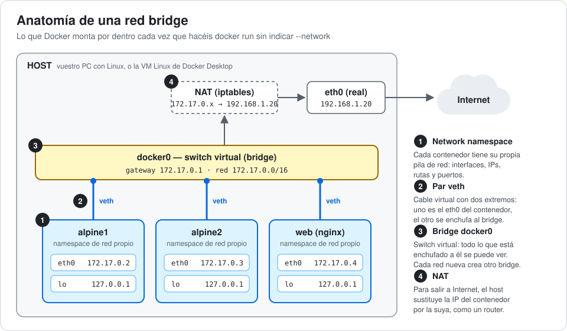
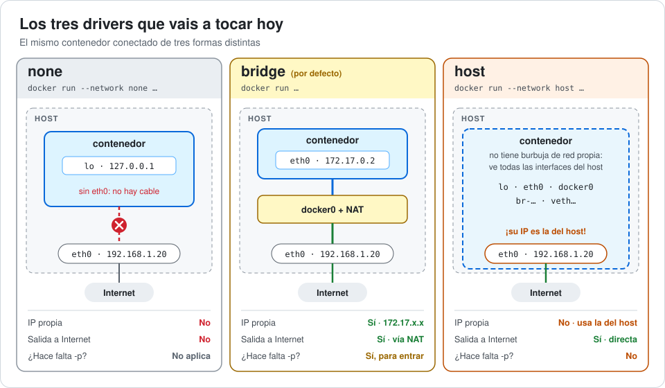
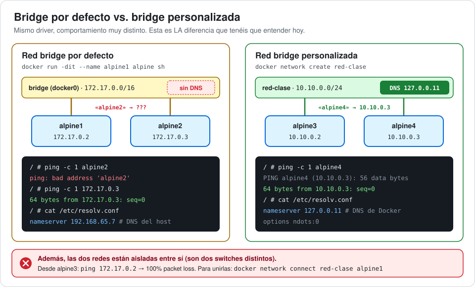
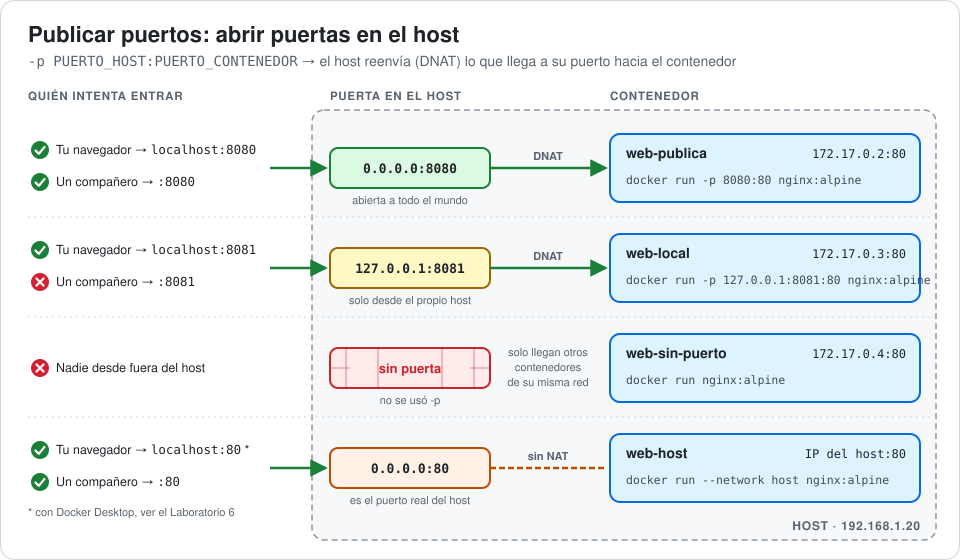
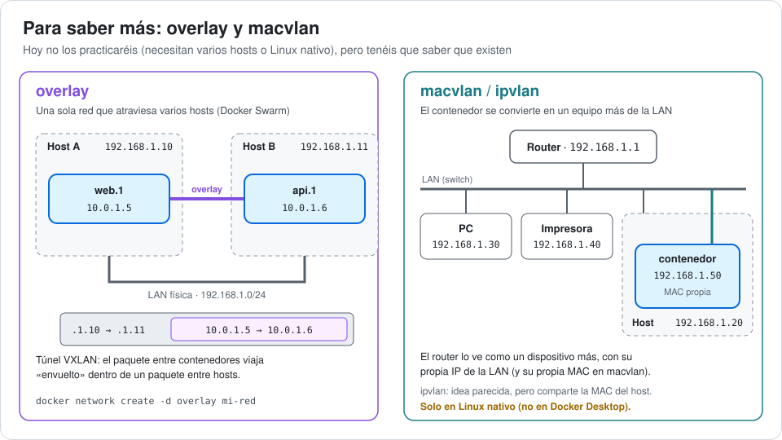
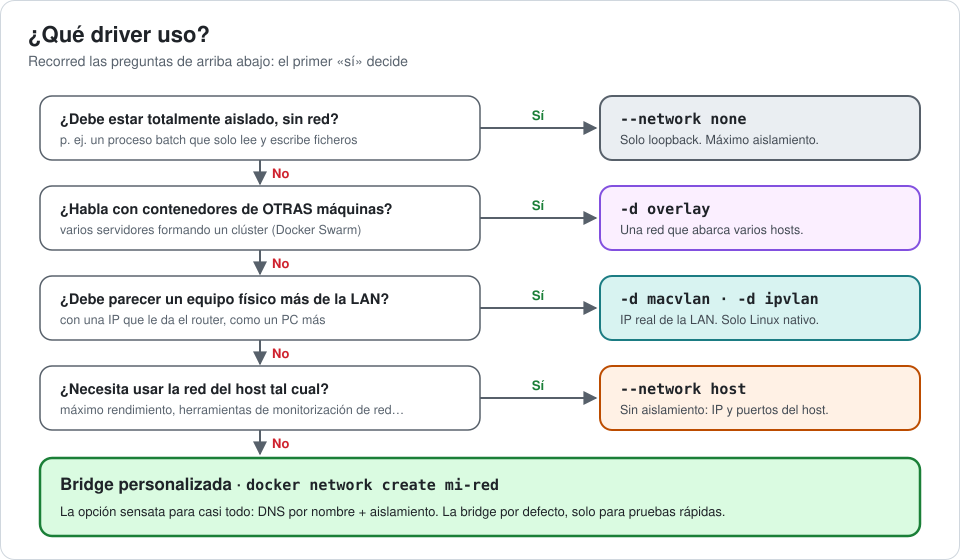
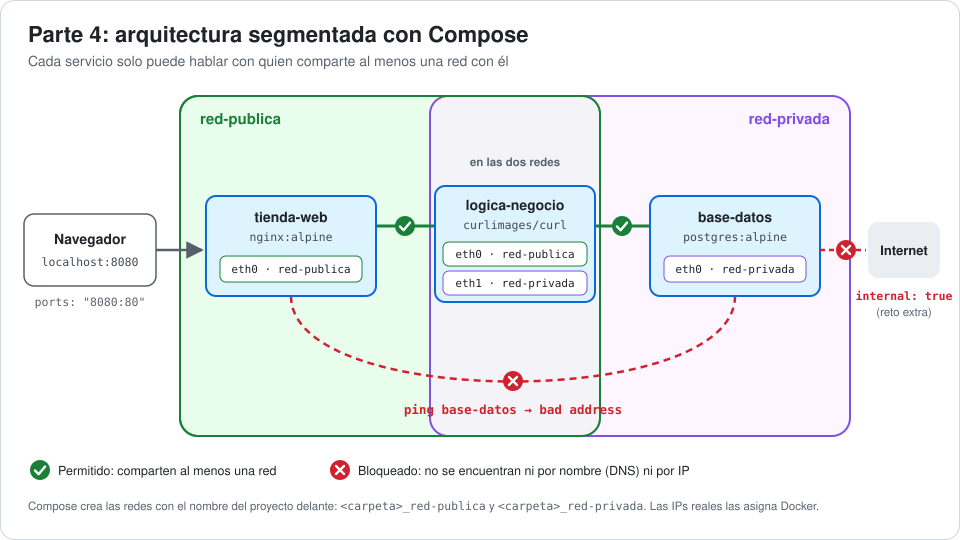

# 🎓 Laboratorio: Master Class de Redes en Docker

**Estado:** Profesor ausente (trabajo autónomo).
**Duración estimada:** 2 h – 2 h 30 min (+ retos 🚀 opcionales).
**Requisito previo:** Saber usar `docker run`, `docker compose up` y git básico. Tener Docker arrancado.

> 💡 **Cómo funciona esta práctica.** En cada laboratorio primero **predecís** qué va a pasar, luego **ejecutáis** y al final **explicáis** por qué ha pasado. Si vuestra predicción falla, ¡mejor! Justo ahí es donde se aprende.
>
> ✍️ **Todo se responde en este mismo README.** Allí donde veáis ✍️, escribid vuestra respuesta justo después de los dos puntos.

### 📦 Qué tenéis que entregar

| Entregable | Dónde | Parte |
|---|---|---|
| Respuestas del cuestionario | huecos ✍️ de este `readme.md` | 2 |
| Predicciones y explicaciones de los laboratorios | huecos ✍️ de este `readme.md` | 3 y 4 |
| Captura del ping por nombre | carpeta `evidencias/` | 3 (Lab 3) |
| Captura de la prueba de fuego | carpeta `evidencias/` | 4 |
| `docker-compose.yml` final | raíz del repo | 4 |

### 🗺️ Mapa de la práctica

| Parte | Qué haréis | Tiempo |
|---|---|---|
| [1. Teoría visual](#-parte-1-teoría-visual-leed-esto-primero) | Entender las piezas: namespaces, veth, bridges, NAT y drivers | 20 min |
| [2. Cuestionario](#-parte-2-cuestionario-teórico-15-min) | Responder en este README y hacer commit | 15 min |
| [3. Laboratorios](#-parte-3-laboratorios-en-la-terminal-50-min) | 6 experimentos: `none`, bridge por defecto, bridge propia, dos redes a la vez, puertos y `host` | 50 min |
| [4. Compose](#-parte-4-arquitectura-segura-con-docker-compose-40-min) | Montar una aplicación de 3 capas con redes aisladas | 40 min |

---

## 📚 Parte 1: Teoría visual (leed esto primero)

Antes de tocar la consola, tenéis que entender cómo funciona la "magia" de las conexiones. Docker crea redes virtuales para que los contenedores se hablen entre sí (o se ignoren).

### 1.1 ¿Qué es "la red" de un contenedor?

Cada contenedor vive en su propia burbuja de red, que en Linux se llama **network namespace**. Dentro tiene sus propias interfaces, su propia IP, su propia tabla de rutas y sus propios puertos. El puerto 80 de un contenedor **no** es el puerto 80 de vuestro ordenador.

Para conectar esas burbujas, Docker usa tres piezas que ya conocéis del mundo físico:

| Pieza virtual | En el mundo real equivale a… |
|---|---|
| **Par veth** | Un cable de red con dos extremos |
| **Bridge** (`docker0`, `br-xxxx`) | Un switch |
| **NAT** (reglas de iptables) | El router de casa: todos salen a Internet con la misma IP |



> 🔍 En el **Laboratorio 6** veréis estas piezas en vivo: `docker0`, los `br-…` y los `veth…` aparecen como interfaces reales del host.

### 1.2 Los drivers de red (los "tipos de cable")

El **driver** decide cómo se conecta el contenedor. Los tres que vais a practicar hoy son:

* **`bridge` (puente):** es el tipo por defecto. Crea una red privada interna en vuestro ordenador. Los contenedores de esta red obtienen su propia IP interna (172.17.x.x). Para salir a Internet usan NAT, como vuestro móvil en el WiFi de casa. Para que alguien de fuera entre, hay que **publicar puertos** con `-p`.
* **`host`:** elimina el aislamiento de red. El contenedor usa directamente la IP y los puertos de vuestro ordenador (el "host"). Si el contenedor escucha en el puerto 80, ocupará vuestro puerto 80 real.
* **`none`:** el contenedor no tiene red. Solo tiene la interfaz de loopback (`localhost`). Útil para trabajos batch que no necesitan red, o cuando la seguridad es lo primero.



| | `none` | `bridge` | `host` |
|---|---|---|---|
| ¿Tiene IP propia? | ❌ Solo `127.0.0.1` | ✅ 172.17.x.x | ❌ Usa la del host |
| ¿Sale a Internet? | ❌ | ✅ Vía NAT | ✅ Directamente |
| ¿Está aislado del host? | ✅ Totalmente | ✅ | ❌ |
| ¿Puede chocar con puertos del host? | No | No | **Sí** |
| Caso de uso típico | Procesar ficheros, máxima seguridad | Casi todo | Rendimiento máximo, herramientas de red |

Existen más drivers (`overlay`, `macvlan`, `ipvlan`). Los veréis en el apartado 1.6.

### 1.3 La diferencia clave: bridge por defecto vs. bridge personalizada

Cuando instaláis Docker, viene con una red llamada `bridge` (su switch es `docker0`).

* **Bridge por defecto:** si no especificáis nada, los contenedores van aquí. **Problema:** no tiene resolución de nombres automática. Para conectar dos contenedores tenéis que averiguar sus IPs a mano, y esas IPs pueden cambiar cada vez que se reinician.
* **Bridge personalizada (*user-defined bridge*):** son las que creáis vosotros (`docker network create` o en el `docker-compose.yml`). **Ventaja:** tienen **DNS automático**. Si llamáis a un contenedor `base_datos`, podéis hacer `ping base_datos` desde otro contenedor de la misma red y Docker resolverá la IP. Ese DNS vive en la IP especial `127.0.0.11` de cada contenedor.



| | Bridge por defecto | Bridge personalizada |
|---|---|---|
| Cómo se usa | No poniendo nada | `--network mi-red` |
| Encontrar a otro contenedor por nombre | ❌ | ✅ DNS interno (`127.0.0.11`) |
| Quién está dentro | Todos los contenedores a los que nadie les asignó red | Solo los que conectéis vosotros |
| Elegir la subred | Solo cambiando la configuración del demonio de Docker | `--subnet 10.10.0.0/24` |
| ¿Cuándo usarla? | Pruebas rápidas | Siempre que haya más de un contenedor |

> 🧩 **Dato importante:** Docker Compose crea **automáticamente** una bridge personalizada para cada proyecto (se llama `<carpeta>_default`). Por eso en Compose los servicios se encuentran por nombre "sin hacer nada".

### 1.4 Publicar puertos: abrir puertas en el host

Un contenedor en una red bridge es invisible desde fuera del host. Para que el mundo pueda entrar, se abre una "puerta" en el host con `-p`:

```
-p PUERTO_DEL_HOST:PUERTO_DEL_CONTENEDOR      (el de fuera siempre va primero)
```



* `-p 8080:80` abre el puerto 8080 en **todas** las interfaces del host (`0.0.0.0`). Puede entrar cualquiera que llegue a vuestro PC.
* `-p 127.0.0.1:8081:80` abre el puerto **solo** para el propio host.
* Sin `-p` no hay puerta: solo llegan al contenedor otros contenedores de su misma red.
* La instrucción `EXPOSE` de un Dockerfile **no publica nada**: solo documenta qué puerto usa la imagen.

### 1.5 Aislamiento de redes

Por seguridad, no queremos que todos los contenedores se vean entre sí.

* **Ejemplo:** un atacante entra en vuestro frontend (la web). Si todo está en la misma red, tiene acceso directo a la base de datos.
* **Solución:** crear redes separadas. El frontend solo habla con el backend. El backend habla con la base de datos. El frontend **no** puede ver la base de datos.

Dos redes bridge distintas son dos switches distintos, y Docker bloquea el tráfico entre ellos. Un contenedor puede estar conectado a **varias redes a la vez** (tendrá una interfaz `eth` por cada una): así se construyen los "puentes" controlados. Lo montaréis en la Parte 4.

### 1.6 Para saber más: overlay, macvlan e ipvlan



* **`overlay`:** una red que se extiende por varias máquinas. La usa Docker Swarm para que contenedores de servidores distintos se hablen como si estuvieran en el mismo switch.
* **`macvlan`:** el contenedor recibe una IP de vuestra LAN real y su propia dirección MAC. Para el router es un dispositivo físico más.
* **`ipvlan`:** parecido a macvlan, pero todos los contenedores comparten la MAC del host.

### 1.7 Resumen: ¿qué driver uso?



---

## 📝 Parte 2: Cuestionario teórico (15 min)

Responded aquí mismo, en el hueco ✍️ de cada pregunta, basándoos en la lectura anterior y en vuestra investigación:

1. ¿Qué comando de consola usarías para ver todas las redes que existen actualmente en tu Docker?

   > ✍️ **Respuesta:**

2. Explica con tus palabras: ¿Por qué es mucho más cómodo usar una "User-defined bridge" en lugar de la red por defecto?

   > ✍️ **Respuesta:**

3. Si uso el driver `host`, ¿puedo mapear puertos con `-p 8080:80`? ¿Por qué?

   > ✍️ **Respuesta:**

4. Investiga: ¿Qué comando usas para ver los detalles de una red (qué contenedores están conectados, sus IPs, etc. Añade la palabra fuenterior a la respuesta.)? 

   > ✍️ **Respuesta:**

5. ¿Qué driver usarías en cada caso? Justifícalo en una línea.
   * a) Un contenedor que convierte vídeos de una carpeta a otra y no necesita red. ✍️ **Respuesta:**
   * b) Una web y su base de datos en tu portátil. ✍️ **Respuesta:**
   * c) Una herramienta de monitorización que necesita ver todas las interfaces de red del host. ✍️ **Respuesta:**
   * d) Un servicio repartido entre tres servidores distintos. ✍️ **Respuesta:**
   * e) Un contenedor que tiene que aparecer en la red del instituto con su propia IP, como un PC más. ✍️ **Respuesta:**

6. Mirando el diagrama del apartado 1.1: ¿qué pieza hace de "cable" y cuál de "switch"? Si un contenedor estuviera conectado a dos redes a la vez, ¿cuántas interfaces `eth` crees que tendría?

   > ✍️ **Respuesta:**

> 💾 **Haced un commit con vuestras respuestas antes de seguir.**
> `git add readme.md` → `git commit -m "Parte 2: cuestionario"`

---

## 🔬 Parte 3: Laboratorios en la terminal (50 min)

Vamos a comprobar la teoría con experimentos. **No uséis Docker Compose todavía.**

Cada laboratorio sigue el mismo formato:

| | |
|---|---|
| 🔮 **Predice** | Antes de ejecutar nada, escribid en ✍️ **Vuestra predicción** qué creéis que va a pasar. |
| ▶️ **Ejecuta** | Lanzad los comandos. |
| ✅ **Deberías ver** | Comparad con la salida esperada (IDs, MACs e IPs pueden variar). |
| 🧠 **Por qué** | Escribid en ✍️ **Qué ha pasado y por qué** vuestra explicación, y **solo después** abrid el desplegable 🧠 **Explicación** para comprobarla. |

> ⌨️ **Convenio:** las líneas que empiezan por `/ #` se escriben **dentro** del contenedor (es el prompt de Alpine). El resto, en vuestra terminal normal. Usad `ping -c 2` para que el ping se pare solo.

> ✍️ Equivocarse en la predicción es normal: **no la corrijáis** después de ejecutar. Lo importante es explicar bien qué ha pasado de verdad.

### Lab 0 · Reconocimiento del terreno (5 min)

▶️ **Ejecuta**

```bash
docker network ls
docker network inspect bridge
```

✅ **Deberías ver** al menos estas tres redes (si habéis usado Compose antes, habrá más):

```text
NETWORK ID     NAME      DRIVER    SCOPE
0e9ba393c46c   bridge    bridge    local
79e84e1179ce   host      host      local
11b8d7f4493d   none      null      local
```

Y dentro del `inspect`, la subred del switch `docker0`:

```text
"Subnet": "172.17.0.0/16",
"Gateway": "172.17.0.1"
```

🧠 Hay una red por cada driver básico. Fijaos en que el driver de `none` se llama `null`. Esa subred y ese gateway son los del diagrama 1.1. Comprobad vuestras respuestas 1 y 4 del cuestionario.

### Lab 1 · `none`: el contenedor incomunicado (5 min)

🔮 **Predice:** ¿qué interfaces de red tendrá el contenedor? ¿Podrá hacer ping a `8.8.8.8`?

> ✍️ **Vuestra predicción:**

▶️ **Ejecuta** (`--rm` borra el contenedor al terminar):

```bash
docker run --rm --network none alpine ip addr
docker run --rm --network none alpine ping -c 2 8.8.8.8
```

✅ **Deberías ver**

```text
1: lo: <LOOPBACK,UP,LOWER_UP> mtu 65536 qdisc noqueue state UNKNOWN qlen 1000
    link/loopback 00:00:00:00:00:00 brd 00:00:00:00:00:00
    inet 127.0.0.1/8 scope host lo
```

```text
PING 8.8.8.8 (8.8.8.8): 56 data bytes
ping: sendto: Network unreachable
```

> ✍️ **Qué ha pasado y por qué:**

<details>
<summary>🧠 <b>Explicación</b> (abridla después de escribir la vuestra)</summary>

Solo existe `lo`. No hay `eth0` ni ruta por defecto: `Network unreachable` significa literalmente "no sé ni por dónde salir".

</details>

### Lab 2 · El dolor de la red por defecto (10 min)

▶️ Lanzad dos contenedores en la red por defecto y entrad en el primero:

```bash
docker run -dit --name alpine1 alpine sh
docker run -dit --name alpine2 alpine sh
docker exec -it alpine1 sh
```

🔮 **Predice:** ¿funcionará `ping alpine2`? ¿Y hacer ping a Internet?

> ✍️ **Vuestra predicción:**

▶️ Dentro de `alpine1`:

```sh
/ # ip addr show eth0
/ # ip route
/ # ping -c 2 8.8.8.8
/ # ping -c 2 alpine2
/ # cat /etc/resolv.conf
/ # exit
```

✅ **Deberías ver**

| Comando | Resultado | Qué significa |
|---|---|---|
| `ip addr show eth0` | `inet 172.17.0.2/16` | Tiene una IP de la red de `docker0` |
| `ip route` | `default via 172.17.0.1 dev eth0` | Para salir, va al gateway: `docker0` |
| `ping -c 2 8.8.8.8` | `64 bytes from 8.8.8.8` | Sale a Internet gracias al NAT |
| `ping -c 2 alpine2` | `ping: bad address 'alpine2'` ❌ | Nadie sabe quién es `alpine2` |
| `cat /etc/resolv.conf` | `nameserver 192.168.65.7` (o el DNS de vuestra red) | Usa el DNS del host, que no conoce a vuestros contenedores |

▶️ Desde fuera, averiguad la IP de `alpine2`. Buscad `"IPAddress"` en la salida de:

```bash
docker inspect alpine2
```

> 💡 Atajo para sacar solo la IP:
> `docker inspect -f '{{range .NetworkSettings.Networks}}{{.IPAddress}}{{end}}' alpine2`

▶️ Volved a entrar en `alpine1` y haced ping a esa IP:

```sh
/ # ping -c 2 172.17.0.3
```

✅ **Ahora sí funciona:** `64 bytes from 172.17.0.3: seq=0 ttl=64 time=0.108 ms`

> ✍️ **Qué ha pasado y por qué:**

<details>
<summary>🧠 <b>Explicación</b> (abridla después de escribir la vuestra)</summary>

Están enchufados al mismo switch, así que se ven, pero solo por IP: el DNS que usan es el del host, y ese DNS no conoce a vuestros contenedores. ¿Os imagináis configurar una aplicación con IPs que cambian cada vez que reiniciáis un contenedor?

</details>

> ℹ️ Usamos `docker exec -it … sh` en lugar de `docker attach`: al hacer `exit` en un `exec` el contenedor sigue vivo. Con `attach`, `exit` lo apaga (para salir sin apagarlo hay que pulsar `Ctrl+P` y luego `Ctrl+Q`).

### Lab 3 · La comodidad de las redes personalizadas (10 min)

▶️ Cread una red con la subred que queráis y dos contenedores dentro:

```bash
docker network create --subnet 10.10.0.0/24 red-clase
docker run -dit --name alpine3 --network red-clase alpine sh
docker run -dit --name alpine4 --network red-clase alpine sh
docker exec -it alpine3 sh
```

🔮 **Predice:** ¿funcionará `ping alpine4`? ¿Qué `nameserver` aparecerá ahora en `/etc/resolv.conf`?

> ✍️ **Vuestra predicción:**

▶️ Dentro de `alpine3`:

```sh
/ # ping -c 2 alpine4
/ # cat /etc/resolv.conf
/ # nslookup alpine4
```

✅ **Deberías ver**

```text
PING alpine4 (10.10.0.3): 56 data bytes
64 bytes from 10.10.0.3: seq=0 ttl=64 time=1.176 ms
```

```text
nameserver 127.0.0.11
options ndots:0
```

```text
Server:     127.0.0.11
Address:    127.0.0.11:53

Name:   alpine4
Address: 10.10.0.3
```

> ✍️ **Qué ha pasado y por qué (¿qué es `127.0.0.11`?):**

<details>
<summary>🧠 <b>Explicación</b> (abridla después de escribir la vuestra)</summary>

`127.0.0.11` es el **DNS interno de Docker**. Lo tiene cada contenedor conectado a una red personalizada y conoce los nombres de todos los contenedores de esa red. Las IPs salen de la subred que elegisteis (`10.10.0.x`).

</details>

> 📸 **Captura de pantalla:** haced una captura donde se vea el `ping alpine4` exitoso por nombre y guardadla en la carpeta `evidencias/`. Haced commit.

🔮 **Predice otra vez:** desde `alpine3`, ¿podréis hacer ping a la IP de `alpine1` (la obtenéis con `docker inspect alpine1`)?

> ✍️ **Vuestra predicción:**

```sh
/ # ping -c 2 172.17.0.2
```

✅ **Deberías ver**

```text
2 packets transmitted, 0 packets received, 100% packet loss
```

> ✍️ **Qué ha pasado y por qué:**

<details>
<summary>🧠 <b>Explicación</b> (abridla después de escribir la vuestra)</summary>

`red-clase` y la bridge por defecto son dos switches distintos y Docker bloquea el tráfico entre ellos. Esto es el **aislamiento** del apartado 1.5.

</details>

### Lab 4 · Un contenedor en dos redes a la vez (8 min)

Los contenedores se pueden conectar y desconectar de las redes personalizadas **en caliente**, sin reiniciarlos.

🔮 **Predice:** si conectáis `alpine1` (que está en la bridge por defecto) también a `red-clase`, ¿cuántas interfaces tendrá? ¿Podrá hacer ping a `alpine3` por nombre? ¿Y a `alpine2`?

> ✍️ **Vuestra predicción:**

▶️ **Ejecuta**

```bash
docker network connect red-clase alpine1
docker exec -it alpine1 sh
```

```sh
/ # ip addr
/ # ping -c 2 alpine3
/ # ping -c 2 alpine2
/ # exit
```

✅ **Deberías ver** dos interfaces, una por red:

```text
2: eth0@if22: <BROADCAST,MULTICAST,UP,LOWER_UP,M-DOWN> mtu 1500 qdisc noqueue state UP
    inet 172.17.0.2/16 brd 172.17.255.255 scope global eth0
3: eth1@if27: <BROADCAST,MULTICAST,UP,LOWER_UP,M-DOWN> mtu 1500 qdisc noqueue state UP
    inet 10.10.0.4/24 brd 10.10.0.255 scope global eth1
```

…y que `ping alpine3` funciona, pero `ping alpine2` sigue dando `bad address 'alpine2'`.

▶️ Mirad la red desde fuera y luego desconectad:

```bash
docker network inspect red-clase
docker network disconnect red-clase alpine1
```

En la sección `"Containers"` del `inspect` aparecerán `alpine1`, `alpine3` y `alpine4` con sus IPs. Tras el `disconnect`, `ping alpine3` desde `alpine1` vuelve a fallar.

> ✍️ **Qué ha pasado y por qué (¿por qué encuentra a `alpine3` por nombre pero no a `alpine2`?):**

<details>
<summary>🧠 <b>Explicación</b> (abridla después de escribir la vuestra)</summary>

Cada red conectada es un cable más (un `veth`) y por tanto una interfaz más. El DNS solo conoce los nombres de las redes personalizadas: `alpine2` vive únicamente en la bridge por defecto, así que nadie puede encontrarlo por nombre. **Esto es exactamente lo que hará `logica-negocio` en la Parte 4.**

</details>

### Lab 5 · Publicar puertos (8 min)

▶️ Lanzad tres servidores web iguales, publicados de tres formas distintas:

```bash
docker run -d --name web-sin-puerto nginx:alpine
docker run -d --name web-publica -p 8080:80 nginx:alpine
docker run -d --name web-local -p 127.0.0.1:8081:80 nginx:alpine
docker ps --format "table {{.Names}}\t{{.Ports}}"
```

✅ **Deberías ver**

```text
NAMES            PORTS
web-local        127.0.0.1:8081->80/tcp
web-publica      0.0.0.0:8080->80/tcp, [::]:8080->80/tcp
web-sin-puerto   80/tcp
```

🔮 **Predice:** ¿cuáles de estas direcciones abrirán la página de nginx en vuestro navegador?

* http://localhost:8080
* http://localhost:8081
* ¿Y cómo llegaríais a `web-sin-puerto`?

> ✍️ **Vuestra predicción:**

▶️ Probadlo en el navegador. Para `web-sin-puerto`, la pista es: *desde otro contenedor de su misma red*.

```bash
docker inspect -f '{{range .NetworkSettings.Networks}}{{.IPAddress}}{{end}}' web-sin-puerto
docker run --rm alpine wget -qO- http://IP_QUE_HAYAS_OBTENIDO
```

✅ Las dos primeras funcionan desde el navegador. A `web-sin-puerto` solo se llega desde otro contenedor, y responde con `<title>Welcome to nginx!</title>`.

> ✍️ **Qué ha pasado y por qué (¿qué diferencia hay entre `-p 8080:80` y `-p 127.0.0.1:8081:80`? ¿Por qué aparece `80/tcp` en `web-sin-puerto` si no publicasteis nada?):**

<details>
<summary>🧠 <b>Explicación</b> (abridla después de escribir la vuestra)</summary>

La diferencia entre `0.0.0.0` y `127.0.0.1` es *quién* puede llamar a la puerta (ver diagrama 1.4): con `0.0.0.0` cualquiera que llegue a vuestro PC; con `127.0.0.1`, solo el propio host. El `80/tcp` de `web-sin-puerto` viene del `EXPOSE 80` de la imagen de nginx y **no publica nada**, es solo documentación.

</details>

> 🚀 **Extra con un compañero:** averiguad vuestra IP (`ipconfig` en Windows, `ip addr` en Linux) y pedid a un compañero que abra `http://VUESTRA_IP:8080` y `http://VUESTRA_IP:8081`. ¿Cuál le funciona?
>
> ✍️ **Resultado (si el firewall de Windows lo bloquea, decidlo también):**

### Lab 6 · Modo `host`: sin burbuja (8 min)

🔮 **Predice:** un contenedor en modo `host`, ¿qué interfaces verá al hacer `ip addr`?

> ✍️ **Vuestra predicción:**

▶️ **Ejecuta**

```bash
docker run --rm --network host alpine ip addr
```

✅ **Deberías ver** muchas más interfaces que en cualquier otro contenedor (resumido):

```text
1: lo: <LOOPBACK,UP,LOWER_UP> ...
3: eth0: <BROADCAST,MULTICAST,UP,LOWER_UP> ...
4: docker0: <BROADCAST,MULTICAST,UP,LOWER_UP> ...
24: br-4760d086883e: <BROADCAST,MULTICAST,UP,LOWER_UP> ...
25: veth84b99dd@...: <...> master br-4760d086883e state UP
29: veth02441aa@...: <...> master docker0 state UP
```

> ✍️ **Copiad la línea del `br-…` que corresponde a `red-clase` y explicad qué es** (pista: comparad los ids con los de `docker network ls`):

<details>
<summary>🧠 <b>Explicación</b> (abridla después de escribir la vuestra)</summary>

**¡Estáis viendo las tripas del diagrama 1.1!**

* `docker0` es el switch de la bridge por defecto.
* Cada red personalizada tiene su propio switch `br-<id>`. Comparad ese id con el de `red-clase` en `docker network ls`: **es el mismo**.
* Cada `veth…` es el extremo de un cable de un contenedor, y `master` os dice en qué switch está enchufado.

</details>

▶️ Ahora un nginx en modo `host`, y además intentad publicar un puerto:

```bash
docker run -d --name web-host --network host -p 9999:80 nginx:alpine
docker ps --filter name=web-host
```

✅ **Deberías ver** este aviso y la columna `PORTS` vacía:

```text
WARNING: Published ports are discarded when using host network mode
```

▶️ Comprobad que nginx está escuchando directamente en el puerto 80 del host:

* **Linux:** `curl http://localhost:80` → página de nginx.
* **Docker Desktop (Windows/Mac):** el "host" es la **máquina virtual Linux** donde corre Docker, no vuestro Windows, así que `http://localhost:80` en el navegador probablemente **no** funcione (salvo que vuestra versión permita activar *Settings → Resources → Network → Enable host networking*). Comprobadlo desde otro contenedor que también esté en modo host:

```bash
docker run --rm --network host alpine wget -qO- http://localhost:80
```

✅ Debe devolver el HTML de `Welcome to nginx!`.

> ✍️ **Qué ha pasado y por qué (¿qué ha pasado con `-p 9999:80`?):**

<details>
<summary>🧠 <b>Explicación</b> (abridla después de escribir la vuestra)</summary>

En modo `host` no hay NAT ni puertas que abrir: el puerto del contenedor **es** el puerto del host. Por eso `-p` se descarta, y por eso dos contenedores en modo host no pueden usar el mismo puerto (ni un contenedor y un programa del host). Si en Linux ya tenéis algo en el puerto 80, mirad `docker logs web-host`.

</details>

### 🚀 Lab 7 (extra) · Un nombre, varios contenedores

▶️ Dos contenedores pueden compartir un mismo **alias** de red:

```bash
docker network create red-alias
docker run -d --name api1 --network red-alias --network-alias api nginx:alpine
docker run -d --name api2 --network red-alias --network-alias api nginx:alpine
docker run --rm --network red-alias alpine nslookup api
```

✅ **Deberías ver** dos direcciones para el mismo nombre:

```text
Name:   api
Address: 172.21.0.2
Name:   api
Address: 172.21.0.3
```

> ✍️ **Qué ha pasado y por qué:**

<details>
<summary>🧠 <b>Explicación</b> (abridla después de escribir la vuestra)</summary>

El DNS de Docker reparte las peticiones entre ambos (*round-robin*). Es un balanceo de carga muy básico, y es lo que ocurre cuando escaláis un servicio en Compose con `--scale`.

</details>

---

## 🧱 Parte 4: Arquitectura segura con Docker Compose (40 min)

Ahora vamos a aplicar todo esto a un entorno real. Tenéis que crear un archivo `docker-compose.yml` desde cero.

### El escenario

Queremos montar una aplicación con 3 capas, pero con seguridad máxima mediante **segmentación de redes**.

1. **Servicio `tienda-web`:** el frontend público.
   * Imagen: `nginx:alpine`.
   * Puerto: mapead el 8080 de vuestra máquina al 80 del contenedor.
2. **Servicio `logica-negocio`:** el backend que procesa datos.
   * Imagen: `curlimages/curl` (la usamos porque trae `curl` y `ping`).
   * Comando: `tail -f /dev/null` (para que no se apague).
3. **Servicio `base-datos`:** donde se guardan los datos.
   * Imagen: `postgres:alpine`.
   * Environment: `POSTGRES_PASSWORD=secret`.

### Las reglas de red (IMPORTANTE)

Debéis definir **dos redes** en el `docker-compose.yml`:

* `red-publica`
* `red-privada`

Configurad los servicios así:

* `tienda-web`: solo pertenece a `red-publica`.
* `base-datos`: solo pertenece a `red-privada`.
* `logica-negocio`: pertenece a **ambas** redes (hace de puente, como `alpine1` en el Lab 4).



> 💡 Si no sabéis cómo se declaran las redes en Compose, buscad en la documentación oficial la clave `networks` de primer nivel y la clave `networks` dentro de cada servicio.

### La prueba de fuego (verificación)

Una vez levantado (`docker compose up -d`), debéis demostrar que el aislamiento funciona.

**1. Las redes existen.**

```bash
docker network ls
```

Deben aparecer `<carpeta>_red-publica` y `<carpeta>_red-privada`, donde `<carpeta>` es el nombre de la carpeta del proyecto.

**2. Desde el frontend.** Entrad con `docker compose exec tienda-web sh`:

```sh
/ # ping -c 2 logica-negocio     # Debe funcionar
/ # ping -c 2 base-datos         # DEBE FALLAR
```

✅ El segundo ping debe dar:

```text
ping: bad address 'base-datos'
```

*Esto es bueno: significa que el frontend no puede tocar la base de datos.*

**3. Desde el backend.** Entrad con `docker compose exec logica-negocio sh`:

```sh
/ # ping -c 2 base-datos         # Debe funcionar
/ # ping -c 2 tienda-web         # Debe funcionar
/ # curl -s tienda-web           # Debe devolver el HTML de nginx
/ # ip addr                      # ¿Cuántas interfaces eth tiene? ¿Por qué?
```

**4. ¿Y si el atacante conoce la IP?** Apuntad la IP de `base-datos` que aparece en el ping del paso 3 (`PING base-datos (172.x.x.x)`). Volved a `tienda-web` y probad:

```sh
/ # ping -c 2 IP_DE_BASE_DATOS
```

✅ **Deberías ver** `100% packet loss`. El aislamiento no consiste solo en "no conocer el nombre": aunque sepas la IP, no hay camino.

> 📸 **Captura de pantalla:** guardad en `evidencias/` una captura donde se vea fallar `ping base-datos` desde `tienda-web`.

Responded aquí mismo:

1. ¿Por qué falla `ping base-datos` desde `tienda-web`? ¿Por qué falla también usando la IP?

   > ✍️ **Respuesta:**

2. ¿Cuántas interfaces `eth` tiene `logica-negocio` y por qué?

   > ✍️ **Respuesta:**

> **Entrega:** Subid el `docker-compose.yml` final. Si no conseguís que falle el ping entre la web y la base de datos, la tarea no está superada.

### 🚀 Retos extra

**Reto 1 · Una base de datos sin Internet.** Una base de datos no necesita descargar nada de Internet, y si alguien la compromete, mejor que no pueda sacar datos hacia fuera. Investigad la opción `internal` de las redes en Compose y aplicadla a `red-privada`. Demostrad que:

* `docker compose exec base-datos ping -c 2 8.8.8.8` → `ping: sendto: Network unreachable`
* `docker compose exec logica-negocio ping -c 2 8.8.8.8` → sigue funcionando. ¿Por qué?

> ✍️ **Respuesta:**

**Reto 2 · Abrir un agujero (y cerrarlo).** Con lo que aprendisteis en el Lab 4, conectad en caliente el contenedor de `tienda-web` a la red privada (los nombres exactos los veis con `docker ps` y `docker network ls`). Comprobad que ahora `ping base-datos` sí funciona desde la web. Explicad por qué esto rompe la seguridad del diseño y volved a desconectarlo.

> ✍️ **Comando que habéis usado y por qué rompe la seguridad:**

---

## 🧹 Limpieza

Al terminar, recordad ser limpios:

```bash
docker compose down
docker rm -f alpine1 alpine2 alpine3 alpine4
docker rm -f web-sin-puerto web-publica web-local web-host
docker network rm red-clase
```

Si hicisteis el Lab 7:

```bash
docker rm -f api1 api2
docker network rm red-alias
```

---

## 📎 Chuleta de comandos de red

| Comando | Para qué sirve |
|---|---|
| `docker network ls` | Listar redes |
| `docker network inspect <red>` | Ver subred, gateway y contenedores conectados |
| `docker network create <red>` | Crear una bridge personalizada |
| `docker network create --subnet 10.10.0.0/24 <red>` | …eligiendo la subred |
| `docker network connect <red> <contenedor>` | Conectar un contenedor en caliente |
| `docker network disconnect <red> <contenedor>` | Desconectarlo |
| `docker network rm <red>` | Borrar una red (sin contenedores conectados) |
| `docker network prune` | Borrar todas las redes que no se usan |
| `docker run --network <red> …` | Arrancar un contenedor en una red concreta |
| `docker run --network-alias <alias> …` | Darle un nombre DNS extra |
| `docker run -p HOST:CONT …` | Publicar un puerto |
| `docker port <contenedor>` | Ver qué puertos tiene publicados |

## 🩺 Si algo falla

| Síntoma | Causa probable y solución |
|---|---|
| `Conflict. The container name "/alpine1" is already in use` | Ya existe de un intento anterior: `docker rm -f alpine1`. |
| `Bind for 0.0.0.0:8080 failed: port is already allocated` | Otro contenedor (o programa) usa ese puerto. Buscadlo con `docker ps` o usad otro puerto. |
| `the input device is not a TTY` en Git Bash | Usad PowerShell, o anteponed `winpty`: `winpty docker exec -it alpine1 sh`. |
| En Git Bash, rutas como `/etc/resolv.conf` se convierten en `C:/Program Files/Git/...` | Pasa al ejecutar comandos "de una línea" desde Git Bash. Usad PowerShell o entrad antes al contenedor con `docker exec -it … sh`. |
| El ping no se para | `Ctrl+C`, y la próxima vez usad `ping -c 2`. |
| He hecho `exit` en `docker attach` y el contenedor se ha parado | Normal. `docker start alpine1` y usad `docker exec -it alpine1 sh` para entrar. |
| `network red-clase has active endpoints` al borrarla | Aún hay contenedores conectados: borradlos primero. |
| En modo `host`, `localhost` no responde desde el navegador | Usáis Docker Desktop: ver el Lab 6. |
